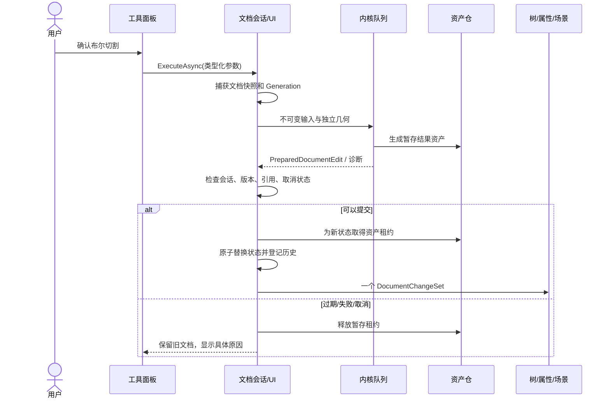

# Cadoryx 命令、事务与存储设计

2026-10-07 当前连接作者格式为 writer **0.7.8**、document **60**、`sketch-regions` **JSON2 / MessagePack3**，仍18分区。完整有向连接表、旧算法空表语义、严格固定中间格式迁移、SameValues/独立原生replay、C1守卫与来源重选已接入；当前完整Release4129/4129和两配置相关2402/2402通过，同构建三语言窗口及通用窗口/圆盘已验。相切动态求解仍待接入，正式求解器保持lm-svd.14。详见[当前连接语义、迁移和证据](B18_REGION_CONNECTION_BRANCHES.md)。本页后续数字保留各自历史阶段背景。

此前 2026-10-07 **status84 整组来源明确重选：新增62项，Release与Debug定向各91/91、相关各2289/2289通过，零失败/跳过；928源码和两配置各113载荷冻结，17共享应用/13SDK托管/实际62原生及隔离SDK1007源码匹配。完整循环/槽位显式映射支持家族及方向变化，仅保留已证明的包含树和输出角色身份；保留整组C1驱动/参考仍拒绝结构变化，旧来源驱动不改绑。三语言来源窗口、后台预览/失效/取消、一次应用撤销、最终独立复验、严格CLI/Agent与可复制ID、计算期间取消/状态竞争已接通，原预算/公差保持。第四候选六组实际窗口、独立实体体积、两级取消/撤销、C1守卫与保存关闭生产重开通过，18完整图像已逐张核对，空绑定日志及零资产。writer0.7.7/document59/18分区保持。当前928源码的完整Release4016/4016通过，零失败/跳过，原3954及新增62完整保留；完整Debug及当前通用窗口未运行。其余来源/C1矩阵、相切分支、曲线路径/变化截面、其余关系/一般交换/全过程及原生历史、A5与A–F继续；正式已验仍A4/B17/C5/D5/E4/F5g，G暂缓。** 见[明确来源重选](B18_EXPRESSION_REGION_RESELECTION.md)。


2026-10-07 此前status66实体/存储快照：

## 最新关联端点、存储与作者窗口

B18本批新增稳定关联端点/解析端点G1-G2 **72项**、独立存储及关联实体重算 **52项**、来源驱动/混合闭环孔岛/求解器注入/三语言VM **36项**，共 **160项通过**；当前Release与Debug联合专项均 **610/610通过**，两配置全方案零警告/错误。当前完整Release **3567/3567通过，0失败/0跳过**；status68原3407、原SDK19全部2936及此前相关791逐项保留，当前完整回归取得实际62原生加载证据。端点为真实变量，每条表达式有两个稳定端点ID及两个结构方程ID，每端点两行解析方程；不使用固定锚点代替关联，结构方程不放进可禁用用户约束表。源控制点/圆半径、反向、起终端G1/G2、表达式共享端点及经端点来源循环已验；局部解仍须提交时整段原生正则性认证，原256变量/512方程/80迭代和公差保持。非构造表达式已接轮廓构建、typed profile引用、混合显式链/孔岛、通用构造切换和删除；C1驱动真实拉伸/旋转、撤销重做/保存重开/恢复和注入伪造端点拒绝通过。仅结构端点加明确FixPoint/圆Radius的系统保留精确固定值；一般接触系统保留原耦合求解及公差，完整输出/关系/分支复验没有绕过。当前writer0.7.4/document56、表达式JSON3/MP4；真实旧JSON1/2及MP2/3明确补空端点元数据，几何schema1、sketches21/features43和17分区保持，禁用坏关系及各自降版分别拒绝。Canvas绘制/命中、实体选择、关联偏移距离/反向/有限修剪、冻结/恢复/解除和关联端点操作已接；当前三语言圆/Bézier作者窗口共6组通过，使用实际应用语言切换，六张完整PNG已审阅。当前圆盘自动验收7次静止光标下画面换页约46.796–52.840ms通过，移鼠不改页；两类WPF和Debug专项均取得实际62原生库、空绑定日志与13SDK文件匹配，隔离SDK1007源码未改，当前885源码和两配置/发布载荷已冻结。上述窗口使用WPF Invoke/Toggle及Canvas PointerPressed路径，圆盘为原生消息加桌面像素复验；物理键鼠另项未验。当前一般/完整window及完整Debug未运行；开放单表达式的实体轮廓列表和扫掠路径registry、完整通用修剪/延伸及区域连接、其他关系作者窗口、一般交换与偏移全过程/原生拆分合并历史继续。B18/A5与A–F仍未完成，G暂缓。

证据：[本批端点/存储/窗口](../artifacts/b18-associative-endpoints-verification-2.json)、[实现说明](B18_ASSOCIATIVE_ENDPOINTS.md)、[下一阶段接入](B18_EXPRESSION_AUTHORING_COMPLETION_PLAN.md)、[原完整B18契约](B18_EXACT_FREEFORM_OFFSETS_PLAN.md)。

## 此前status68解析接触与原子关系存储

B18新增解析源坐标/半径/参数敏感度 **51项**、表达式有限接触 **184项**、原子关系存储/历史 **66项**，共 **301项通过**；连同原表达式分区36项，本轮联合专项 **337/337通过**。当前Release完整 **3407/3407通过**，原SDK19全部2936及此前相关791逐项保留；当前Debug专项 **337/337通过**，两种配置全方案构建均零警告/错误。固定参数和SolveA/SolveB/SolveBoth的有向G1/G2已用生产解析Jacobian接通真实源控制点/半径；原固定作者、关联/冻结/解除来源、部分原生区间、反向和来源链保持。G1不消费未证明的曲率导数；同一周期结点上固定G1可用、高阶/自动参数所需连续性未证明时拒绝。局部接触求解通过仍须文档命令的整段原生认证，其他位置折叠整笔拒绝。关系随独立表达式表原子挂载并保持原约束顺序；新writer0.7.3/document55、表达式JSON2/MessagePack3，几何schema1、sketches21/features43与17分区保持。旧JSON1/MP2明确补空关系且原基础草图字节不变；新关系夹带到旧document54或旧分区各自拒绝。直线原生工厂与作者长度的单浮点单位端点差异已按明确作者端点映射修复，没有夹紧修剪、放宽公差或修改预算。实际62原生库、13SDK程序集和隔离SDK1007源码匹配保持；当前878源码及两配置载荷已冻结。此前status67一般/完整window功能断言、129PNG和圆盘静止像素证据属于此前构建；当前新增表达式作者/接触选择UI及当前WPF未运行，完整Debug3407未运行。CadSketch表达式仍限构造曲线，稳定关联端点/非构造轮廓/Canvas选择、完整偏移命令与三语言作者窗口、一般交换及偏移全过程/原生拆分合并历史继续；B18/A5与A–F仍未完成，G暂缓。

证据：[解析接触与当前回归](../artifacts/b18-expression-contacts-verification-1.json)、[接触与存储说明](B18_EXPRESSION_CONTACTS.md)、[关联端点下一阶段](B18_ASSOCIATIVE_ENDPOINTS_PLAN.md)、[完整B18契约](B18_EXACT_FREEFORM_OFFSETS_PLAN.md)。

## 此前status67配方轮廓与有限交换

B18已接配方层精确表达式轮廓、混合闭环/孔岛、真实拉伸/旋转/扫掠/放样及有限求值/投影/交点：新轮廓专项 **46/46通过**，连同原基础51和实体73共 **170/170通过**；相关 **791/791通过**，原650逐项保留。Release全方案零警告/错误。原作者区间、方向、每层距离与原1e-8面积/1e-7体积公差保持；圆/直线在guided原生算法及有限交换路径中使用代数相同表示，作者树和原BRep资产不替换。STEP真实圆/实体体积、嵌套共享/位置/整体颜色及IGES真实表面/展平已核对；当前仅无源样式的简单拉伸/旋转可作临时圆/直线转换，一般自由曲线偏移明确拒绝且原目标文件/资产不变。当前writer0.7.2，document54/features43，17分区；sketches21、表达式节JSON1/MessagePack2与几何schema1保持，旧features42原8字段几何迁移不改值，所有配方嵌套位置夹带表达式均拒绝。隔离SDK1007源码、13SDK程序集与实际62原生库未改；SDK19原853源基线中29有明确改动、824保持，当前源码/载荷另冻结。同程序集一般smoke/完整window功能断言通过，129完整PNG保留并审阅、实际62原生库与空绑定日志核对；圆盘7次静止指针像素换页通过，移鼠标不改页。局部特征语言夹具未同步WPF全局语言，图像仍有混合语言文字，完整语言切换未验。当前完整3106/Debug及新增表达式作者WPF工作流未运行。CadSketch表达式仍限构造曲线，稳定端点/G1/G2/自动参数、完整偏移命令/三语言作者UI、一般交换及原生拆分/合并历史继续；B18/A5与A–F仍未完成，G暂缓。

证据：[轮廓与交换验证](../artifacts/b18-profiles-verification-1.json)、[轮廓说明](B18_EXPRESSION_PROFILES.md)、[完整B18契约](B18_EXACT_FREEFORM_OFFSETS_PLAN.md)。 [当前窗口与图像](../artifacts/b18-profiles-window-verification-1.json)。

B18继续完成构造表达式实体/稳定ID、同草图来源链、解除/冻结/恢复关联、原子重算和距离参数接入：新专项 **73/73通过**、相关 **650/650通过**，原几何基础51项及前一轮610项逐项保留，Release全方案零警告/错误。完整基区间跟随完整来源，部分修剪区间保留原生参数；来源家族变化、循环、缺失来源、求解器篡改及偏移折叠均整笔拒绝。独立主文件表达式节JSON1/MessagePack2保留几何schema1、稳定ID及拥有值来源，document52→53明确补空表，保存重开/恢复/撤销重做和旧几何字节保持已验。当前writer0.7.1、17分区，既有sketches21/features42保持；实际62原生库与13SDK文件匹配、隔离SDK1007源码不变。原853个SDK19源基线中18个有明确改动，835个保持；运行基线JSON和独立codec另更新；本轮五个新生产文件、两个新测试文件另行冻结。当前表达式限构造曲线，端点/G1/G2/滑动接触、精确轮廓/实体消费者、完整偏移编辑/区域命令及三语言WPF和STEP/IGES交换尚未接齐；现有参数编辑器三语言VM选择/预览/取消另通过。当前完整3060、Debug及生产表达式窗口未运行；旧SDK19全量2936/129PNG属于冻结接入基线。B18/A5及A–F仍进行中，G暂缓。

证据：[实体与主存储验证](../artifacts/b18-entities-verification-1.json)、[实体与存储说明](B18_ENTITY_STORAGE.md)、[完整B18契约](B18_EXACT_FREEFORM_OFFSETS_PLAN.md)。

2026-10-04 [D4整体实体偏移](D4_SOLID_OFFSET.md)：document40/features36，必需能力cadoryx.solid-offset.1；solid-offset保存一个来源和一个signed Distance，严格拒绝companion及旧schema夹带。原document38→39/features34→35独立迁移保持；新增39→40/35→36。SDK仍锁定curve-inspection.8，其他节schema不变；37专项/178联合/2065全量及同冻结六窗口通过。

2026-10-04 [F5f文件与供应商记录](F5_FILE_AND_PROVIDER_TOOLS.md)：精确快照原生保存、STEP/IGES/STL和BOM/HTML/Package/ExchangeAudit输出完成本地契约；184联合、1947全量、Release零警告／错误及同冻结三窗口通过，12个生产DLL与实际LM Studio探针一致、绑定日志为空。真实LM Studio十三轮、8→12 mm³/undo/redo/八轮附件复查/保存通过，实际HTTP负载和两次协议失败保留；两张已检查截图及视口边界见artifacts/f5-files-verification-1.json。Codex app-server/gpt-5.6-luna同生产程序集十三轮工具会话也通过，两个供应商分别取证；多文档、完整工程图及其余A–F仍继续，G暂缓。

2026-10-03 [F5e通用建模工具](F5_COMMON_MODEL_TOOLS.md)十二类作者契约、创建／编辑／精确重选／解除及完整作者查询已验证：170联合、1910全量、Release零警告／错误、同冻结十窗口及实际终端通过。证据artifacts/f5-model-verification-1.json区分四张已检查截图、长输出视口、供应商和物理指针边界。F5f文件／工程图／报告与真实长会话及其余A–F继续，G暂缓。

2026-10-03 [F5命令与参数](F5_COMMANDS_AND_PARAMETERS.md)：终端令牌贯穿生产会话，DocumentCommandExpectation在锁内校验实际文档/状态；撤销/重做和AI终端入口受同一守卫。参数/驱动/基准/时间线查询及cad_parameter的作者编辑复用生产参数重算，不新增存储schema。F5a/b冻结证据通过，F5c预览游标的单独身份、抑制/恢复/合法重排已通过最终164专项和三窗口检查，1788全量的JSON小修边界单列，临时游标不序列化。

2026-10-03 F4：DeliveryOutput追加ExchangeAudit=3，旧值保持。独立实测ZIP使用schema1，report.json绑定快照身份、内核、选项及源/输出哈希；exchange-audit实际写出与重读，verify-exchange只检验完整性和内部一致性。取消/失败保旧输出；原生文档与图纸schema不变。见[F4记录](F4_MEASURED_EXCHANGE.md)；[F5计划](F5_COMMAND_AND_AGENT_PLAN.md)继续实施。

2026-10-03 F3h：[双面尺寸与中面](F3H_PLANAR_SIZE_FEATURES.md)独立升级drawings v12，必需能力cadoryx.planar-manufacturing-sizes.1。Datum/Frame/Binding追加键8/14/3，独立证据键0–11；v11→12拒绝旧版新字段包括nil/空/新枚举，10→11保持固定旧格式。保存/加载分别重验两处原始面、作者及完整有限域，无解析器拒绝；失败保旧文件。document39/features35/sketches16/datums2/history3及SDK保持。

2026-10-03 F3g：[组合钻孔历史](F3G_COMPOSED_DRILLING_HISTORY.md)独立升级history节v3，新增cadoryx.topology-history.3及cadoryx.composed-drilling-history.1。单物理来源组合map schema3新增终止状态5/6；旧1→2固定v2、2→3保留旧adapter与证明，拒绝夹带。精确与旧语义入口都原生重放完整关系。drawings11/document39/features35/sketches16/datums2和SDK保持，下文是历史记录。

2026-10-03 F3f：[原始附着历史](F3F_ORIGINAL_ATTACHMENT_HISTORY.md)使drawings独立升级v11，必需能力cadoryx.original-attachment-history.1，附着DTO追加键14保存单层作者来源。v10→v11独立迁移，旧版新字段夹带包括nil拒绝；v6–v10中间格式剥除新字段。有效延续附着保存/加载原生重放并逐项核验当前绑定，无历史解析器拒绝；失效旧资产仍保留并按BRep角色加载。作者来源查询使用方法，避免自指向属性被record格式化与JSON递归展开。document39/features35/sketches16/datums2及SDK不变。

2026-10-03 F3e：[有类型制造基准系统](F3E_TYPED_DATUM_SYSTEMS.md)使drawings独立升级v10，必需能力cadoryx.typed-manufacturing-datums.1。有序/共同基准及每引用材料边界、尺寸证明和实际基准绑定完整持久化；v9→v10独立迁移，旧版新字段夹带包括nil拒绝，v6–v9固定中间DTO保持实际旧键长度。有效尺寸保存/加载逐项原生重验，缺sizeResolver拒绝；旧轴标注保旧标失效。document39/features35/sketches16/datums2及SDK不变。

2026-10-03 F3d：[关联孔坐标](F3D_ASSOCIATED_HOLE_COORDINATES.md)使drawings独立升级v9，必需能力cadoryx.hole-datum-coordinates.1；v8→v9要求旧表没有键9/10，新nil/空数组夹带亦拒绝。有效表核对同零件的类型明确C2来源、frame/修订/孔坐标缓存，旧数值表保持frame；失效保存保旧、明确重选或解除。document39/features35/sketches16/datums2及SDK不变，历史插入保作者ID/数值frame并允许关联缓存刷新。

2026-10-03 F3c：[当前制造孔表](F3C_CURRENT_MANUFACTURING_HOLE_TABLES.md)使drawings独立升级v8，必需能力cadoryx.current-hole-tables.1；v7→v8要求旧字段缺失，旧版本夹带新空数组亦拒绝。有效行保存/加载逐行原生重验尺寸和证据，无IDrawingHoleResolver拒绝；失败保存保留旧文件，失效行保留以待显式重选。历史守卫按内容核对表/行作者数据；当前document39/features35/sketches16及锁定SDK不变。

2026-10-03 F3b：[模板复用](F3B_TEMPLATE_LIBRARY.md)使drawings升级v7，增加文档内具名模板库、source-free版本1的.cadtemplate文件和制造图框中的栏位/备注/分区；必需能力cadoryx.drawing-template-library.1。v6→v7独立迁移要求新字段缺失，旧版夹带显式空数组也拒绝；其他schema及锁定包不变。事务编辑、明确替换、应用保留视图/标注来源、跨文档导入、保存重开和损坏拒绝已联合验证。

2026-10-03：[F3a](F3A_ASSOCIATED_ANNOTATIONS.md)drawings v6保存精确任意面/边附着、基准符号、有序基准ID、公差框、装配气泡、名称/数量缓存和零件表位置；新增必需能力cadoryx.manufacturing-annotations.1。v5→v6独立迁移，旧字段必须缺失（显式空新数组也拒绝），原布局/缓存保持。创建/编辑/移动/重选/依赖删除及关联刷新统一事务；原始BRep重验、晚到关闭租约、失效PDF原子保护、保存重开后的历史插入已联合验证。document39/features35等其他schema与上游包不变。

2026-10-03：[F1](F1_EXACT_SECTION_HATCHING.md)drawings v3精确材料缓存、v4明确材料规则；[F2](F2_MANUFACTURING_TEMPLATES.md)v5制造模板。三步独立迁移分别拒绝旧版夹带新类型/规则/模板；旧v3剖面线和旧v4图框保持原缓存/布局，不隐式重投影。新增必需能力cadoryx.section-hatch-rules.1与cadoryx.manufacturing-templates.1，原cadoryx.section-hatching.1保留；document39/features35等其余schema不变。来源/比例/材料赋值及规则更新在同一事务重裁剖面和局部图，失败保留缓存并标待处理，过期PDF拒绝导出。模板字段、纸张、边距、语言和投影法完整撤销/重做及持久化。下文为历史记录。

[D3 抽壳/拔模](D3_SHELL_DRAFT.md)几何、精确面配方、事务命令、C1壁厚/逐面角度、C2中性平面及存储已接入，专项22/22、联合112/112；完整回归运行中，生产窗口及D3最终验收未完成。当前 document v26/features v27；D1/D2独立迁移与旧版夹带拒绝保留。A–F整体继续，G暂缓。

[D2 扫掠／放样](D2_SWEEP_LOFT.md)几何、来源、存储和生产编辑已接入，专项44/44、三语言实际控件PASS，6张截图检查及空绑定日志；最终全量920/920、Release零警告/错误，桌面/C1–C4/D1/D2/图纸/PDF同版联合门禁PASS（20261001-214924），八份绑定日志空、资产归零。当前 document v25/features v26。下一步[D3抽壳/拔模](D3_SHELL_DRAFT_PLAN.md)锁定消费者43/43、62 DLL匹配，应用接入继续；整个A–F未完成，G暂缓。

2026-10-01：[D1](D1_ADVANCED_EXTRUSION.md)追加 PackExtrusion Key(15)，document v24/features v25、能力 cadoryx.advanced-extrusion.1。布尔目标消费与终止参考依赖分别表示；联合基准/草图/特征图重算，精确面变化冻结并明确重选。旧正方向配方不改变，独立迁移拒绝旧版夹带高级配置。

2026-10-01：[C4](C4_STANDARD_HOLES.md)追加 PackHole Key(14)，document v23/features v24、能力 cadoryx.standard-holes.1，十五节不变；标准名称/版本、规格/尺寸、入口/方向、基准身份全部保存。联合依赖图包含基准来源特征，原生重算前刷新基准平面；多字段暂存后验证最终候选。单阶段孔保留验证历史，两阶段沉孔/沉头明确不伪造组合历史。


2026-10-02：[B8 曲线及孔岛旋转](B8_CURVE_AND_REGION_REVOLVE.md)引入 document33/features31，必需能力 cadoryx.curved-region-revolve.1；其余schema保留。完整作者曲线、孔岛和关联轴进入配方/缓存/持久化；旧features30夹带新旋转语义及其他建模操作字段拒绝。此前段落是当期历史记录，整个A–F继续。

2026-10-01：[C3](C3_MIRROR_AND_PATTERNS.md)引入 features v23 的重复配方 Key(13)，能力 `cadoryx.result-repetition.1`；document v22/十五节不变。保存来源精确几何、重复类型/帧、数量/间距/整圈、组合或融合、持久副本 ID 与基准身份/修订。v22→v23 独立迁移拒绝旧版夹带新配置。原件生产特征保留、可见输出被消费；参数字段全部暂存后验证最终候选，副本及 Boolean 后继在同一事务中更新。副本 GUID 不当成边面历史证据。

2026-10-01：[C2](C2_ASSOCIATED_DATUMS.md)引入 document v22 / datums v1；共十五节 MessagePack，新增必需能力 cadoryx.associated-datums.1。基准保存稳定身份/配方/局部框架/来源修订，绑定保存草图 ID 及明确实例工作平面。v21→v22 空表迁移独立于参数迁移；旧版夹带新节拒绝。参数字段、基准、草图、原生特征、截面与工程图在同一事务中更新，明确解除保留当前框架。

2026-10-01：[C1](C1_PARAMETER_EXPRESSIONS.md)引入 document v21 / parameters v1；共十四节 MessagePack，新增必需能力 cadoryx.document-parameters.1。保存稳定参数/绑定 ID、名称、量纲、表达式和显式设计值参考；计算值与临时预览不序列化。v20→v21 独立引入空参数表，旧版夹带新节拒绝；生产会话和预览统一进行参数、草图/特征、关联截面与工程图后处理。features v22/sketches v11 不变。

2026-10-01：[B7](B7_SKETCH_FINISHING.md)增加圆弧半径/等半径、倒角、多角草稿历史与显式关联轮廓转换。sketches v11，新增必需能力 `cadoryx.sketch-arc-radius.1`；document v20/features v22 不变。v10→v11 独立迁移拒绝旧版夹带弧尺寸（含禁用关系）。默认保存圆角半径驱动；临时角点对应不序列化，明确勾选后保存新的有序边界 ID；未选/过期/歧义引用原子拒绝。倒角退距仍为创建尺寸。

2026-09-30：[B6](B6_SKETCH_FILLET.md)当时复用现有点/线/三点弧和端点相切记录，document v20/features v22/sketches v10 与能力不变。该历史批次的持续半径及显式轮廓更新限制已由 B7 补齐。

2026-09-30：[B5](B5_PARAMETRIC_ENDPOINT_TANGENCY.md)将 sketches v9→v10，复用 `endpoint-tangent-curves` 的 A/B/Joint 及平滑分支数值 1，扩大目标为现有二次 Bézier/夹持均匀三次样条。新增必需能力 `cadoryx.sketch-parametric-tangency.1`。v9→v10 保留旧圆弧相切与身份，拒绝旧 v9 夹带指向 Bézier/样条的新关系（含禁用）；v8→v9 保留独立。document v20/features v22 不变。

2026-09-30：[B4](B4_ENDPOINT_TANGENCY.md)将 sketches v8→v9，新增 `endpoint-tangent-curves`：A/B/Joint 三个目标 ID、严格为 1 的平滑分支及 Enabled。必需能力 `cadoryx.sketch-endpoint-tangency.1`；独立迁移保留旧坐标/关系，拒绝旧 v8 伪装新关系（含禁用）及未知分支。B3 的 v7→v8 保持独立；document v20/features v22 不变。

2026-09-30：[B3](B3_LOOP_OFFSET_AND_BASIC_RELATIONS.md)将 sketches v7→v8，复用现有约束记录保存 `midpoint-point-line`（两目标/零数值）及 `symmetric-points-line`（三目标/零数值）。新增必需能力 `cadoryx.sketch-basic-relations.1`。v7→v8 保留旧几何并拒绝旧版本伪装的新关系（含禁用关系）；v6→v7 投影迁移保留独立。单闭环偏移保存既有几何类型的独立副本，不增加来源关联；document v20/features v22 不变。

2026-09-30：[B2](B2_CURVE_EDIT_OFFSET_PROJECTION.md)将 sketches v6→v7，草图 Key(12) 保存关联投影列表；每条记录以数字键保存来源草图/实体 ID、来源 Revision、目标实体 ID 和锚定约束 ID。新增必需能力 `cadoryx.sketch-projection.1`。v5→v6 的样条迁移保持独立；v6→v7 保留旧数据且拒绝旧版本夹带投影字段。document v20、features v22 不变。文档读取验证同零件来源、类型/修订、投影缓存和无环依赖；来源编辑先刷新下游草图，再统一重算关联特征，一次预览/提交/撤销覆盖整条链。

2026-09-30：[B1](B1_SKETCH_EDIT_AND_REVOLVE.md)将 features v21→v22，新增圆、圆弧加弦与直线—圆弧旋转配方，复用既有数值和曲线字段；写出器声明必需能力 `cadoryx.analytical-revolve.1`。v20→v21 的单特征抑制迁移保留为独立步骤；v21 的旧数据不得夹带新旋转配方。document/sketches 版本不变，直线修剪/延伸继续保存现有点和线结构。

M4-S3s–x 的 features v12→v13 迁移只接受没有多边形孔字段的旧配方／草图引用；v13 的配方 Key(7) 保存多边形孔顶点，引用 Key(5) 保存逐孔直线 ID。写出器及完整范围见[多边形草图通孔](POLYGON_SKETCH_HOLES.md)。

2026-10-01 的历史写出器为 0.7.0／document v22／features v22／sketches v11／parameters v1／datums v1／feature-bindings v2／external-parts v1／engineering-review v1／drawings v2／十五节 MessagePack。document v16→v17 显式引入工程审阅节，保存关联截面、固定点标注和审阅视图，见 [M6 收尾](M6_COMPLETION.md)。document v12→v13 增加装配关系表，旧文档迁移为空表；v13→v14 追加两个局部轴字段；v14→v15 引入空 external-parts 节，v15→v16 为关系追加目标角度字段。document 节数字键 8–10 保存当前文档的网格显示、毫米间距和吸附；键 11–12 保存竖直天空渐变的顶部／底部 ARGB 色，后续键保存原点轴及工作平面设置。document v7→v8 补默认网格；v8→v10 补默认天空渐变；v9→v10 将旧单色复制到两端。设置命令进入撤销历史。H2-C1 以独立 `history-queries` v1 节保存诊断查询；H2-C2 的 `feature-bindings` v1 保存用户确认后的历史边身份，v2 另存当前精确 BRep 的生成边及倒角支撑面。features v6 记录过期位，v7 增加单边双距离倒角的可选第二距离，v8 追加十二条 Box 边掩码及单边圆角终点半径，v9 为绑定圆角追加可选终点半径，v10 开放绑定倒角配方，v11 增加单圆关联拉伸及互斥圆引用，v12 增加显式圆孔几何和稳定孔 ID，v13 增加多边形孔顶点和稳定线环 ID，v14 增加三点圆弧加隐式弦拉伸和稳定 ArcId，v15 增加直线圆弧混合闭环及有序实体 ID；sketches v4 保存圆弧实体。旧 document v5/v6 经显式规则添加空查询／绑定节；features v6/v7/v8 和 feature-bindings v1 均按显式规则迁移，sketches v2→v3 开放切线及角度约束，v3→v4 增加三点圆弧；features v13→v14 增加圆弧拉伸，v14→v15 增加直线圆弧混合闭环，v15→v16 增加多圆弧及混合曲线孔，v16→v17 增加单层岛屿，v17→v18 增加二次 Bézier 区域，sketches v4→v5 增加 Bézier 实体，features v18→v19 增加三次 B 样条独立区域、sketches v5→v6 增加样条实体，并拒绝将新类型伪装成旧版本；BRep 资产保持不变。详见 [历史诊断查询](HISTORY_QUERIES.md)、[跨特征绑定](HISTORY_FEATURE_BINDINGS.md)、[局部结果精确拓扑](EXACT_LOCAL_TOPOLOGY.md)、[圆形草图区域](CIRCULAR_SKETCH_PROFILES.md)和[圆孔拉伸](CIRCULAR_SKETCH_HOLES.md)。

M9 追加 document Key(19) 的自由平面变换，以及 features 配方／草图关联的样条孔、混合曲线控制点和递归区域树。旧 document v17 与 features v19 分别显式迁移到 v18/v20；把新字段伪装成旧格式会拒绝，不能把缺失变换猜成用户自定义平面。区域树的节点、深度、重用 ID 与缓存几何一致性约束见 [M9 草图区域](M9_SKETCH_REGIONS.md)。M10 将 document v18 显式迁移到 v19，保存装配关系两端的精确 BRep 基准引用；旧手输关系保留空基准来源，不能伪装解析几何证据。详情见 [M10 装配](M10_ASSEMBLY.md)。

M11 将 document v19 显式迁移到 v20，并引入独立 `drawings` v1 节；旧文件生成空图纸，当前文件缺节拒绝。图纸来源含实例/Body/生产 Feature、资产、几何修订和位姿；尺寸使用精确解析基准，投影与数值缓存随上游编辑一起更新或过期。PDF 与 CLI 不从过期内容生成交付文件。详见 [M11 工程图](M11_TECHNICAL_DRAWINGS.md)。

2026-09-13 更新：H2-B1 将多输入历史证据接入布尔命令，重算整体替换、撤销精确恢复。当前应用写出版本 0.4.5，document v5、history v2，共八节 MessagePack。旧 document v4 文件先迁移为空 history v1，再明确升级为 v2；旧局部历史保留原证据，不自动重算。详细契约见 [多输入历史](MULTI_INPUT_HISTORY.md)，原单输入设计见 [算法历史](TOPOLOGY_HISTORY.md)。H2-B2 已接入生产布尔逐源证据，详见 [布尔历史](BOOLEAN_HISTORY.md)；以下阶段记录保留原版本背景。

本文保留目标行为，并记录当前实现。2026-09-12 已接通候选编辑、Dispatcher 提交、精确资产历史、MessagePack 文件、三格式导出与恢复快照；后续预算、通用迁移等目标以[路线图](ROADMAP.md)标示，接口草案不一定与当前类名逐字一致。

## 1. 三条操作路径

| 操作 | 入口 | 是否修改文档 | 撤销策略 |
|---|---|---|---|
| 新增体、布尔、移动实例、修改名称/材料、草图参数 | DocumentCommand | 是 | 文档撤销/重做 |
| 旋转相机、选择、临时隐藏、切换工作平面/工具 | EditorCommand | 默认否 | 编辑器独立历史或不记录 |
| 打开文件、另存为、导出、关闭文档 | Workspace/Application Service | 管理文档生命周期 | 不作为几何编辑命令入栈 |

“保存命名视图”是文档命令；“鼠标旋转视图”是编辑器命令。“持久隐藏对象”是文档命令；“临时隔离选择”是编辑器命令。UI 要使用不同的语义动作。

Ctrl+Z 默认撤销模型编辑，Alt+Left 等视图历史功能可另设快捷键。不能让用户刚完成切割后按十次 Ctrl+Z 才跳过相机拖动。

`MainWindowViewModel` 的 Save/Undo/Redo 路由到当前 DocumentSession。CanExecute 来自当前会话能力、历史状态与关闭状态；命令执行完才能更新成功提示。树和属性面板也只调用相同入口。

## 2. 文档命令两阶段执行

```csharp
// DTO、Snapshot、Result 均不暴露 OcctSharp 或 WPF 类型。
public interface ICadDocumentCommand
{
    string Name { get; }
    ValueTask<PreparedDocumentEdit> PrepareAsync(
        DocumentReadContext context,
        CancellationToken cancellationToken);
}

public interface ICadEditorCommand
{
    string Name { get; }
    EditorChangeSet Execute(EditorCommandContext context);
}
```

`DocumentReadContext`：DocumentSnapshot、DocumentVersion、只读资产租约、内核服务。`PreparedDocumentEdit`：ExpectedVersion、目标状态或补丁、资产暂存租约、预计算 DocumentChangeSet、诊断。它可被 Dispose，未提交则释放暂存结果。



详细约定：

1. Prepare 可在内核队列执行，不能修改当前文档或发布 UI 事件；元数据命令可以同步准备。
2. 内核输出先完成 BRep 合法性/有限值/结果数量验证，再进入可提交状态；失败返回带目标 ID 的诊断。
3. 提交运行在 Session 所属 UI Dispatcher，核对 DocumentId、Generation、会话寿命和输入修订；取消请求优先于尚未开始的提交。
4. 正式提交前完成新不可变状态、差量、历史节点和所需资产租约的准备，避免提交后才序列化几何或申请关键资源。
5. 在一个短临界区内交换状态/历史引用并递增 Generation；临界区内没有外部回调、await 或原生慢操作。
6. 提交完成后再通知订阅者。渲染或树投影失败不回滚已成功的文档，而是记录诊断并从快照重建投影。
7. 同一会话的提交串行化。首次实现对过期结果直接拒绝并允许用户重试；不要自动将依赖旧选择的布尔结果合并到新文档。
8. 完全无变化的命令不生成 StateId/历史；可重复的清空选择等也不制造噪声。

每个内核命令显式定义输入是否消耗、是否保留、输出为零是否允许。例：Cut 全部被切除可以产生“目标体删除”的有效结果，但不能被误报为导入失败或拿空 Shape 显示。

## 3. 撤销、重做和批量

```text
HistoryEntry
  EntryId / BatchId / Name / CompletedAt
  BeforeStateId / AfterStateId
  BeforeSnapshot / AfterSnapshot（不可变结构共享）
  ForwardChangeSet / ReverseChangeSet
  AssetLeases（两个状态所需的精确资产）

DocumentHistory
  UndoEntries / RedoEntries
  Settings（最大条目数、估计字节预算、批量显示策略）
```

几何操作 Undo/Redo 恢复已提交状态和资产，不重跑内核。重跑可能受内核版本、公差、运算顺序影响，也浪费时间。大体几何按资产共享，不能在每条记录里重复存完整 BRep 字节。

- Undo 恢复 BeforeStateId，Redo 恢复 AfterStateId；两者都递增 Generation，清理失效 Selection，并发布对应差量。
- Undo 后新执行编辑，释放整个 Redo 分支持有的租约；当前状态与其他历史仍引用的资产保留。
- 历史裁剪按条目和估计内存/磁盘预算同时控制；只有真正没有消费者的资产才能删除。
- 保存只更新 SavedStateId，不清空用户历史。已保存状态被历史裁掉时依然保留 SavedStateId 比较信息。
- 原生 OCAF 的内部命令仅用于候选计算上下文回滚；不得同时接受 UI Undo，使两份历史各自前进。
- 关闭/重新打开文件，首版不恢复运行时撤销栈；特征设计历史持久化，用户命令撤销历史不等于特征树。

批量支持两种业务语义：

| 批量类型 | 行为 | 适用 |
|---|---|---|
| Atomic | 全部在暂存状态准备，任一步失败不提交；一条复合历史 | 导入装配、一次变换多个实例 |
| Sequential | 子命令分别成功提交，共享 BatchId，可按步或批撤销 | 脚本、命令行连续操作 |

`UndoMode/RedoMode` 可以是应用级可变偏好，由历史弹出时读取；不能在加入批次时固定死。Atomic 已是一条记录，不能再拆成内部步骤撤销。混合“选对象→修改文档→旋转相机”的脚本分别调用编辑器和文档通道，批次关联仅用于活动日志，不强行把相机装成文档修改。

## 4. 工具状态机与预览

```text
Idle -> CollectingInput -> Validating -> PreviewPending -> PreviewReady
                            |                  |               |
                            +--> Invalid <-----+               +-> Committing -> Idle
任何可取消阶段 -> Cancelling -> Idle
```

一个 `ModelingToolSession` 拥有 ToolId、输入版本、输入参数、临时选择、错误和 PreviewLease。鼠标/数值输入递增 PreviewGeneration；只接纳最新预览结果。预览不占文档历史，不改变 IsDirty。

参数链必须一致：工具默认值 → 任务面板编辑 → 类型/单位验证 → 预览请求 → 最终命令。最终确认时检查预览使用的文档版本和参数版本；相同才可提升为正式结果，否则重新准备。不能界面看起来是 10mm，最终创建却读取另一个默认值。

退出工具、Esc、文档切换/关闭都释放预览；原生计算尚未结束时标记废弃，返回后再释放。撤销提交后的建模操作由文档历史处理，而不是恢复已销毁工具对象。

## 5. 差量更新与诊断

`DocumentChangeSet` 至少包含：

| 分类 | 字段/含义 | 下游影响 |
|---|---|---|
| Structural | Added/RemovedDefinitions、Slots、Bodies | 树结构、实例展开、Selection 校验 |
| Geometry | BodyId + Old/NewGeometryRevision | Presentation、网格/包围盒/质量缓存 |
| Placement | 所属定义和 ChangedSlotIds | 所有相关实例世界变换、场景范围 |
| Appearance | 对象/图层/材料 ID、变化通道 | 统一外观重新解析 |
| Metadata | 名称、用户属性 | 树文字、属性、文档信息 |
| Feature | Dirty/ChangedFeatureIds | 特征树、重算诊断 |
| Topology | 已删除/失效/成功映射的引用 | 标注、选择、依赖特征 |
| Settings | 单位/公差/命名视图等 | 对应 UI 和派生数据 |

差量携带 DocumentId、Before/AfterStateId、Generation；订阅者发现漏代际可以请求完整快照。批量提交先归并差量，删除优先消除同批的新增/修改噪声。大量引用定义更新时使用反向索引，不只更新当前选中的实例。

`CadDiagnostic`：稳定 Code、Severity、MessageKey/Args、ObjectTarget、OperationId、可选技术细节。日志本地化显示消息，测试断言 Code；内核异常的原始文本可写诊断详情，不能把所有错误都吞成“操作失败”。

## 6. `.cadoryx` 容器

当前实现选择 ZIP 容器 + UTF-8 JSON 清单 + MessagePack 3.1.8 结构节 + 独立 BRep/XDE 资产。MessagePack 的紧凑数值表达适合 CAD，但不取代业务版本、关系验证或内核序列化；性能收益仍需真实模型基准。使用 `[MessagePackObject]` 与显式 `[Key(n)]`，Standard resolver、UntrustedData、最大对象深度 128；禁止 Typeless/Contractless。MessagePack 压缩关闭，由 ZIP 统一压缩。

```text
model.cadoryx
├ manifest.json
├ sections/document.msgpack      # 文档身份、单位、公差、根定义
├ sections/structure.msgpack     # Part/Assembly、Slots、Bodies
├ sections/features.msgpack      # 配方、依赖、结果、空结果输出属性
├ sections/geometry.msgpack      # 修订 ID → BRep、包围盒、体积、源 XDE 引用
├ sections/sketches.msgpack      # 草图平面、稳定实体和约束；不保存瞬时求解报告
├ sections/topology.msgpack      # 版本化语义引用；不保存解析状态或 native 序号
├ sections/presentation.msgpack  # 图层、外观、材料
├ extensions/<index>.bin         # 未知可选节，保留原始编码和载荷
└ assets/<sha256>.bin            # BRep 或嵌入 XDE 上下文
```

以上是实际写出的目录结构。sketches 节已实现；网格输入、独立 references 节、命名视图和缩略图仍未实现。XDE 上下文不是所有文档的必需项。所有被当前特征图作为 Source 输入的旧几何资产也属于“当前可达资产”，不能只保存可见 Body 的最新 BRep。

`manifest.json` 必需字段：

| 字段 | 用途 |
|---|---|
| format / containerVersion | `Cadoryx` 与 ZIP 内约定版本；与各节版本独立 |
| documentId / stateId | 文件中的文档身份与保存快照身份 |
| applicationVersion / assetCatalogVersion | 当前写出 0.4.1 / 1；与节版本分别演进 |
| requiredCapabilities[] | 当前必需能力；未知能力拒绝加载 |
| sections[] | kind、path、schemaVersion、encoding、required、length、sha256 |
| assets[] | id、path、length、sha256、format；format 含媒体类型、编码/格式版本、内核及写出库版本 |

每个 section/asset 的 hash 针对未压缩载荷字节。禁止把绝对路径、XdeLabel.Entry 或进程指针当作资产路径/业务身份。Header 指格式清单摘要，不把“ZIP 没有自定义头”混同为必须实现另一个头格式。

## 7. IO API 与版本迁移

规划接口：

```text
ReadManifestAsync(path)                  # 不加载 OCCT
ReadSectionAsync<TDto>(path, kind)       # 按节版本执行迁移
ReadDocumentSettingsAsync(path)          # 设置预览
LoadAsync(path, options)                 # 验证后返回独立 LoadedDocument
SaveAsync(snapshot, assets, path)        # 只保存捕获的快照
```

容器版本、每节 SchemaVersion、资产编码版本、特征参数版本是四个不同维度。一个新草图字段不需要让每个几何资产重新编码，也不能只递增容器号而不提供节迁移。

当前迁移严格匹配 `(kind, schemaVersion, encoding)`，由 `RegisterStep` 声明多个输入/输出。M3-V 迁移步骤先将旧 v1/json 逐节迁移为 v2/messagepack；structure/features v2 联合提取 geometry 表，输出 structure/features v3 和 geometry v1；该步骤的 document/presentation 保持 v2，再接续下述 M4-S1 迁移。迁移结果全组校验、检查容量和取消后才接纳；缺步骤、依赖缺失、输出冲突或修订定义冲突会拒绝加载。旧 JSON `Register/Read` 辅助 API 保留，实际存储使用新流水线。字段 Key 和持久枚举编号不得重排或复用；破坏兼容的变更提升节版本。解码后拒绝尾随字节、非法配方、未来必需节，并执行整个领域图验证。完整协议和固定样本见 [格式演进](FORMAT_EVOLUTION.md)。

M1-Q 为 PackAppearance 追加可选 Key(2) PreserveSourceStyles；旧 Key(0)/Key(1) 不变，缺失字段默认 false。它只控制源 XDE 显示样式，v2 编码保持不变；新文件在旧程序重存可能丢失该新标志。旧两字段字节样本与当前原生保存均有回归，细节见 [交换与视口](EXCHANGE_AND_VIEWPORT.md)。

M4-S1 接续迁移：document v2 → v3 同时初始化空 sketches v1。v3 表示 sketches 权威表必须存在；M4-S1 当时六节版本为 document/structure/features v3、presentation v2、geometry/sketches v1。新增必需能力 cadoryx.sketches.1；旧五节文件中的 ID、状态、资产不变。读取不运行求解器，设置读取仍只消费 document。详见 [草图基础](SKETCH_FOUNDATION.md)。

M4-S2 再迁移 sketches v1→v2，添加稳定初始 Revision；features v3→v4，旧特征保持空 SketchSource，即冻结轮廓。M4-S2 当时为 document/structure v3、features v4、presentation/sketches v2、geometry v1。新增必需能力 cadoryx.sketch-association.1。关联引用、修订、缓存轮廓与所属零件均验证，失效数据不得静默重算修补；详见[草图编辑协议](SKETCH_EDITOR.md)。

未知版本处理：

- 新于当前能力的必需节/必需特征拒绝编辑，可在已保存结果足够时提供明确标记的只读模式。
- 未知可选节及其附属资产/格式原样保留，文档只读；不承诺已知 DTO 中任意未知字段的透传。可选资产即使声明未来 OCCT 格式，也只复制；当前几何实际依赖的资产必须通过兼容性检查。
- BRep/上下文资产先验证 hash，再由合适内核版本尝试解码；不假设 OCCT 任意跨版本都可往返。
- 迁移只改变内存表示，不改变 ID/StateId 和保存点；下次保存写当前格式，普通保存可原子替换原路径，另存为可保留旧版副本。失败保留旧目标，不自动制作永久备份。
- `ReadDocumentSettingsAsync` 只迁移 document 节；它不应该强制创建 Viewer、读取所有 BRep 或等待草图求解。

## 8. 保存、打开与恢复协议

保存步骤：

1. 在 UI 通道捕获 DocumentSnapshot / StateId，取得当前可达资产的只读租约；随后 UI 可继续编辑。
2. 在目标同目录创建唯一临时文件；写入载荷、长度/hash 和清单，关闭 ZIP 并刷新文件。
3. 重新读取验证清单、必需节、资产引用/hash；根据操作系统支持对已存在目标原子替换，新目标同卷移动完成。
4. 成功后将 SavedStateId 更新为本次捕获的 StateId。若 UI 已编辑到另一个 StateId，仍显示未保存；不能直接设置 IsDirty=false。
5. 同一文档的普通保存串行化，避免旧快照晚完成覆盖新快照。另存为成功后才更新当前路径；失败不改路径和保存点。
6. finally 释放只读租约与本次临时文件；失败不删除旧目标。网络/特殊文件系统原子性能力需检测，不能承诺完全相同的崩溃保证。

打开步骤：清单/容量检查 → DTO 解码与迁移 → 全图引用校验 → 资产校验/必要的内核解码 → 构造独立 Session → 加入 Workspace。任一步失败释放临时资源，不替换用户当前文档。

只读缩略图/文件摘要无需全模型解码。完整编辑打开可延迟加载部分几何，但必须明确未加载和已验证范围；不能把缺失资产状态显示为有效可编辑模型。

自动恢复保存到独立恢复目录和独立文件，不更新 SavedStateId、不覆盖用户文件；记录原路径、时间、DocumentId/StateId。首版恢复粒度是最近完整恢复快照。以后需要更细颗粒度再增加带校验和的日志，不把内存历史序列化成任意 CLR 对象。

上述恢复协议已落地为 `DocumentRecoveryService` + `CadRecoveryStore`：30 秒定时、两代完整快照、进程排他锁、损坏回退、正常关闭清理，以及恢复窗口的“恢复为未保存副本”。恢复交接先建立新持久副本再退休来源；详细磁盘结构和验收见 [RECOVERY.md](RECOVERY.md)。

容器防护属于格式实现：限制总解压大小、单条目大小、数量和嵌套深度；拒绝重复规范路径、路径穿越、同名大小写歧义与符号链接；只在受控目录提取文件；不执行附件。外部引用默认不自动访问网络。

## 9. 交换与原生保存的区别

`.cadoryx` 是设计文档，保存业务身份、参数、结构、资产和设置。STEP/IGES 是交换文件，不能承诺保留 Cadoryx 的所有特征、草图约束或命令历史。

- STEP/IGES 默认使用 XDE 读取名称、颜色、装配和受支持元数据；geometry-only 入口只用于用户明确要求仅几何的场景。
- 导入生成候选文档/候选定义子图，建立 `SourceIdentity -> Cadoryx ID` 映射后整体提交；重新导入独立源需要明确替换或新增策略。
- 导出从一致快照构建专用 XDE/Shape 上下文；导出失败不修改活动文档。
- 未映射的 PMI、样式、外部引用等记录为诊断/来源附件。附件只保留来源，不能保证编辑后仍能正确映射回目标几何。
- 输出前生成能力/信息损失报告，区分完整支持、近似、将丢弃。只有确实有信息损失需要用户决定时才要求选项；日常无损导出可按已保存偏好执行。
- 导出成功不改变 `.cadoryx` 保存点。

## 10. 验收用例

| 用例 | 必须观察到的结果 |
|---|---|
| 布尔内核抛错 | 状态/历史/资产可达关系保持原样，显示具体诊断 |
| 计算中撤销/关闭文档 | 旧结果不能提交，返回后资源释放 |
| 多实例共享零件后修改尺寸 | 所有相关实例几何更新，实例位置保留 |
| 撤销布尔后重做 | 恢复相同 GeometryRevision 和结果资产，不重跑算法 |
| 保存 S2、编辑 S3、撤销 S2 | IsDirty=false；Generation 比之前更大 |
| 保存过程中发生新编辑 | 文件保存捕获快照；当前文档仍显示未保存 |
| 改批量撤销偏好后撤销 | Sequential 批次按当前设置处理；Atomic 保持单条 |
| 修改参数的旧预览晚返回 | 不覆盖最新预览；取消不留下正式 Body |
| 文件保存中断/无磁盘空间 | 原文件可打开；没有错误更新保存点 |
| 旧版本只读取 settings | 仅迁移需要的节，不初始化 OCCT |
| 改写/缺失一个几何资产 | hash/引用检查报错，不部分加载成成功文档 |
| 未支持的未来特征 | 明确只读或拒绝编辑，不静默删除特征后保存 |
| 同名零件/重复子装配实例 | 依靠 ID/完整路径定位，树和 Viewer 选择一致 |

M4-T1 新增 document v3→v4 与 topology v1 空表迁移，当前为七节。topology-references.1 为必需能力；保存语义引用和来源修订，禁止保存临时拓扑序号或解析缓存。注册/重选需当前修订和唯一 native 解析；重算保持原引用，精确历史恢复旧快照。协议及失效规则见 [拓扑引用基础](TOPOLOGY_REFERENCES.md)。

M4-T2 将 features v4→v5，增加白名单 local-box-edge 配方；应用版本 0.4.2、必需能力 cadoryx.local-box-edge.1。七节目录不变，旧 v4 不得夹带新配方。局部参数/源缓存/轴序/依赖在解码后全图验证，失败拒绝加载；事务/预览/取消和原生生命周期见 [局部建模](LOCAL_FEATURES.md)。


2026-10-04 [F5f多文档工具](F5_WORKSPACE_TOOLS.md)：空工作区新建、原生/交换打开、精确会话激活、动态活动文档和自主切换保留会话完成本地契约；255联合、1974全量、Release零警告／错误及同冻结三窗口PASS，十二生产DLL在测试/探针/发布一致。真实Codex八轮多文档、24 mm³建模/保存/重开/切换通过，资产归零；LM Studio五次多文档尝试仍FAIL（工具遗漏修复后有额外创建/重复新建/空回复），明确保留为未通过。终端真实控件及两张截图视口边界见artifacts/f5-workspace-verification-1.json。完整工程图、LM Studio验收及其余A–F继续，G暂缓。
